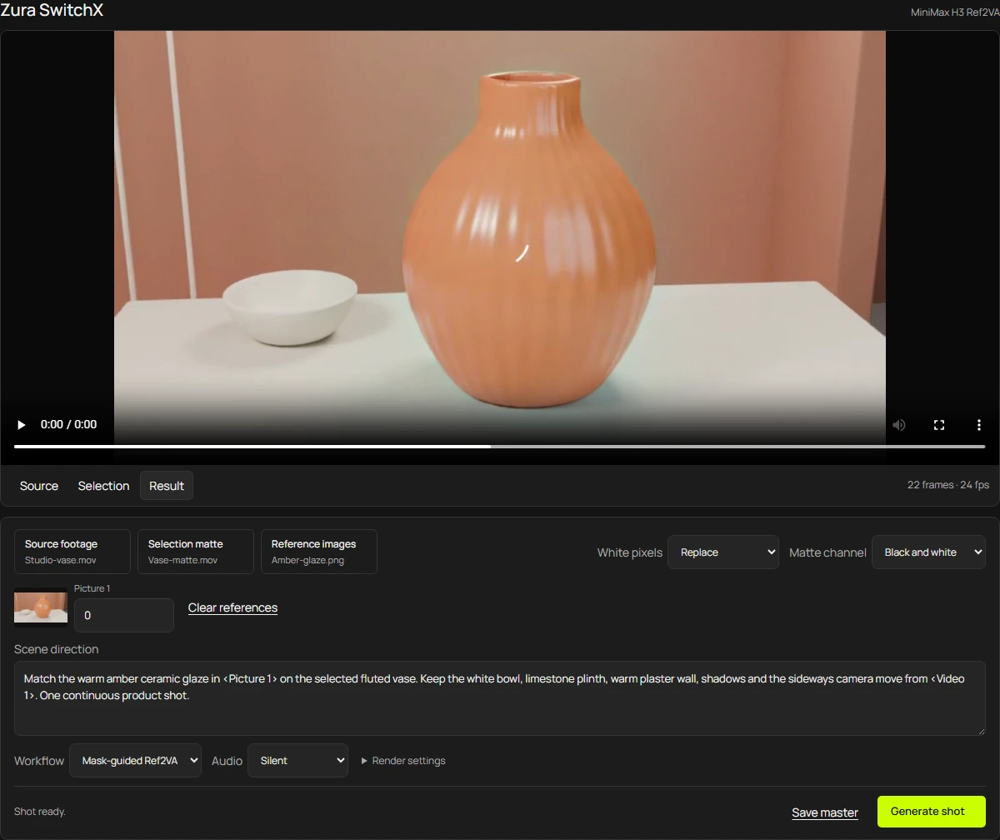

# Zura SwitchX

Choose **Video → Zura SwitchX** in Zura Studio. Use it for a new location, a lighting change, or an edit to a performer, prop or part of the set.

## Render a shot

1. Add source footage. Choose **Native Ref2VA** for the standard MiniMax video-reference workflow. Add up to four appearance images in selection order. Refer to them as `<Picture 1>` through `<Picture 4>` and to the source as `<Video 1>`.
2. For a regional edit, choose **Mask-guided Ref2VA** and add a matte. Select **Keep and relight** when white covers the material to preserve. Select **Replace** when white marks the subject or object to change. **Embedded alpha** reads the actual alpha channel. A still matte also works.
3. Open **Selection** and scrub the shot to check coverage. Green shows a keep selection and amber shows a replacement. The source and animated matte must have the same dimensions and frame count. A paired matte follows the source by frame index.
4. Describe the action and lighting. In the masked workflow an edited reference can be pinned to a numbered source frame. Frame zero is the opening. A registered opening image helps establish the new composition before the camera moves.
5. Choose **Source audio**, **Choose audio** or **Silent**, then **Generate shot**. A selected recording conditions the H3 performance and supplies the soundtrack. Review the spoken section for lip sync.
6. Compare the result with the source at the same playhead position. **Save master** downloads the full render. **Graph view** opens the editable ComfyUI graph.

## Reuse a Character Replacement selection

With an approved Character Replacement project active, open Zura SwitchX, choose Mask-guided Ref2VA and select **Use reviewed selection**. This imports the exact reviewed clip and its frame-matched mask. The import uses the separate original selection when the review contains one. Older reviews carry their saved matte, including any margin baked into it. For original-resolution work, upload the camera master and a matching full-resolution matte.

Replacement margin expands the area H3 can regenerate around an object. Set it to zero for the exact supplied silhouette. The keep operation uses the supplied selection without expansion.

## Rendering and limits

The complete selected shot goes through one H3 video sampler and one video decode. Masked rendering reuses Character Replacement’s source-latent preservation and soundtrack lock. Source detail controls how strongly protected structure guides denoising. Source depth guidance is optional and uses Depth Anything V2 and the H3 Fun ControlNet. Replacing a white selection also uses the H3 Fun ControlNet. The native workflow uses its standard 24 fps H3 frame grid and supports video references up to 15 seconds. Mask-guided delivery supports source-indexed shots up to 20 seconds and restores the source raster, frame count and timestamps. The H3 long-edge setting determines generation resolution. A larger delivery raster is resized from the decode.

Use the installed H3 Ref2VA transformer, H3 text encoder and both H3 VAEs. Eight-step Turbo uses its Ref2VA adapter. ProRes export requires FFmpeg. Fine edges, fast motion, occlusion and complex camera moves are shot-dependent. Review the output before using it as a final VFX plate.

The revised vase example includes the teal source footage, a white-replace matte, the amber opening reference, the submitted API graph, a preview and a lossless RGB master. Its graph removes the original glaze colour from the selected pixels before H3 encodes the shot. The 24 px replacement margin gives H3 room to render the contact shadow. [Download the revised example](https://github.com/ZURAVFX/ComfyUI_zura_nodes/releases/download/v1.3.77/Zura-SwitchX-amber-vase-revised.zip).

Model references: [MiniMax H3](https://huggingface.co/MiniMaxAI/MiniMax-H3) and [H3 Fun ControlNet Union 2.0](https://huggingface.co/alibaba-pai/MiniMax-H3-Fun-Controlnet-Union-2.0).
